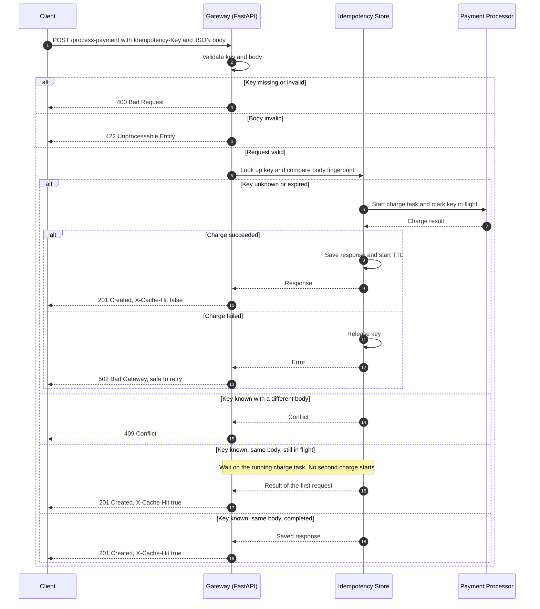

# Idempotency Gateway

## Overview

This API simulates payment processing and is designed to let clients retry requests safely using an `Idempotency-Key`. It uses FastAPI and an in-memory store in a single worker process to save and replay payment responses.

The diagram describes the target design. Implementation is being added in tested increments; the ADRs record the decisions and their limits.

## Architecture diagram

## Design decisions

- [ADR 0001: FastAPI with an in-memory store](docs/adr/0001-fastapi-and-in-memory-store.md)
- [ADR 0002: Request validation and fingerprinting](docs/adr/0002-request-validation-and-fingerprinting.md)
- [ADR 0003: Concurrent requests share one charge task](docs/adr/0003-in-flight-requests-share-one-charge-task.md)
- [ADR 0004: Failed charges release their key](docs/adr/0004-failed-charges-release-the-key.md)

## Developer's choice

[ADR 0005: Idempotency keys expire](docs/adr/0005-idempotency-keys-expire.md) defines a configurable retention window and periodic cleanup. Retrying after expiry creates a new payment; records are also lost on process restart.
