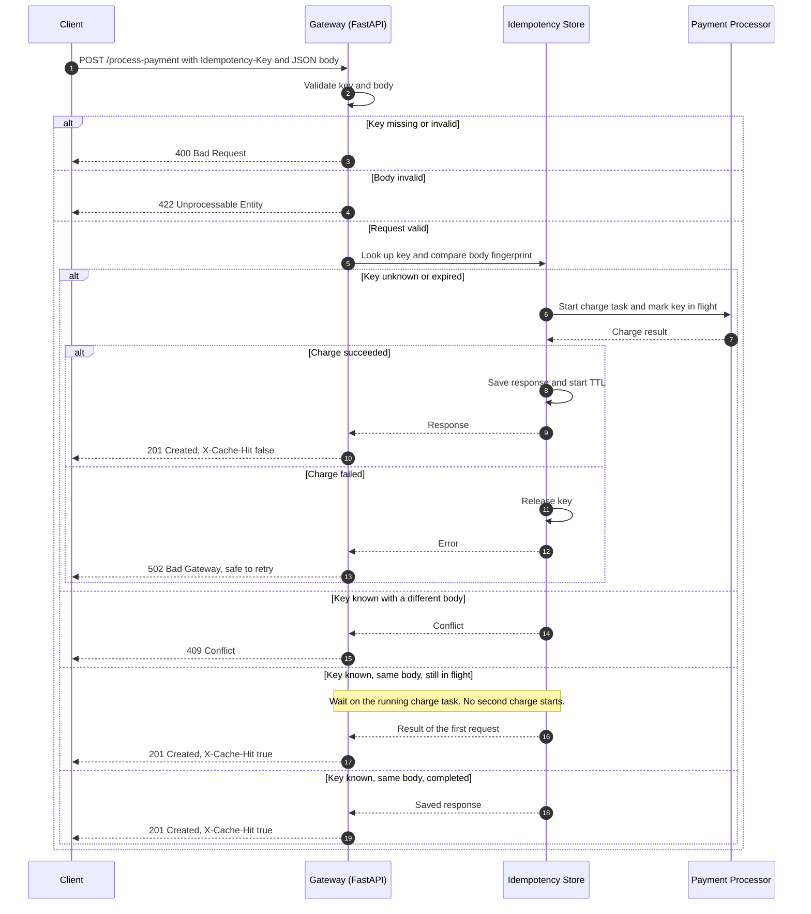

# Idempotency Gateway

## Overview

This API simulates payment processing and is designed to let clients retry requests safely using an `Idempotency-Key`. It uses FastAPI and an in-memory store in a single worker process to save and replay payment responses.

The diagram describes the request flow; the ADRs record the decisions and their limits.

## Architecture diagram



## Setup

Install Git and Python 3.11 or newer. No database or external service is required.

Clone the repository if you do not already have it:

```text
git clone https://github.com/Bixzare/AmaliTech-DEG-Project-based-challenges.git
```

Start the following commands from the repository root (`AmaliTech-DEG-Project-based-challenges`). If your terminal is already inside `backend/Idempotency-gateway`, skip the first `cd` command. Create the virtual environment once; on later visits, activate it and start the server.

### Windows Command Prompt (CMD)

```bat
cd backend\Idempotency-gateway
python -m venv .venv
.venv\Scripts\activate.bat
python -m pip install -r requirements.txt
uvicorn app.main:app --port 8000
```

### Windows PowerShell

```powershell
cd backend\Idempotency-gateway
python -m venv .venv
.\.venv\Scripts\Activate.ps1
python -m pip install -r requirements.txt
uvicorn app.main:app --port 8000
```

If PowerShell blocks the activation script, use the virtual environment's interpreter directly from the project folder:

```powershell
.\.venv\Scripts\python.exe -m pip install -r requirements.txt
.\.venv\Scripts\python.exe -m uvicorn app.main:app --port 8000
```

Confirm that `python --version` reports Python 3.11 or newer before creating the environment.

### macOS or Linux

```bash
cd backend/Idempotency-gateway
python3 -m venv .venv
source .venv/bin/activate
python -m pip install -r requirements.txt
uvicorn app.main:app --port 8000
```

Confirm that `python3 --version` reports Python 3.11 or newer before creating the environment.

### Check the running server

Open [the health endpoint](http://127.0.0.1:8000/health); it should return `{"status":"ok"}`. Open [the interactive API documentation](http://127.0.0.1:8000/docs) to send payment requests. Stop the server with `Ctrl+C`.

Run one worker process. The in-memory store is not shared across workers, and restarting the server clears its records.

### Run the tests

Stop the server, or open another terminal in the project folder and activate the same virtual environment. Then run:

```text
python -m pip install -r requirements-dev.txt
python -m pytest -q
```

On Windows, activation is optional if you use the explicit interpreter path:

```text
.venv\Scripts\python.exe -m pip install -r requirements-dev.txt
.venv\Scripts\python.exe -m pytest -q
```

### Configuration

Set environment variables before starting the server. Invalid settings prevent startup and report the variable that needs correction.

| Environment variable | Default | Rule | Purpose |
|---|---|---|---|
| `PROCESSING_DELAY_SECONDS` | `2.0` | Finite, at least zero | Simulated payment processing delay |
| `IDEMPOTENCY_TTL_SECONDS` | `86400` | Finite, greater than zero | Retention window for completed responses |
| `IDEMPOTENCY_SWEEP_INTERVAL_SECONDS` | `60` | Finite, greater than zero | Interval between expiry sweeps |
| `SIMULATION_CONTROLS_ENABLED` | `true` | `true`, `false`, `1` or `0` (case-insensitive) | Enable the manual failure-control endpoint |

The TTL starts when a charge succeeds. Replaying a response does not extend its expiry, and in-flight charges never expire. Expired entries are removed on lookup and by the background sweeper. A retry at or after expiry starts a new charge, even with the same key and body.

To try a failed payment without restarting the server, open `/docs` and send `{"count": 1}` to `POST /simulation/fail-next-charges` under **Simulation**. The next new charge waits for the configured processing delay and returns `502`. Retry the same payment with the same key to receive `201`; the failed attempt did not consume the key. The count can be an integer from 0 to 100, replaces the pending count, and zero clears it. Set `SIMULATION_CONTROLS_ENABLED=false` before starting the server to remove this route entirely. This control is only for the simulated processor.

## API documentation

Base URL: `http://127.0.0.1:8000`. Interactive documentation is at `/docs`; the OpenAPI schema is at `/openapi.json`. No authentication is required for this local simulation.

| Method | Endpoint | Purpose |
|---|---|---|
| `POST` | `/process-payment` | Process a new payment or replay its saved result |
| `GET` | `/health` | Confirm the server is responding |
| `POST` | `/simulation/fail-next-charges` | Configure failures in the simulated processor |

### POST /process-payment

Send `Content-Type: application/json` and an `Idempotency-Key` header. The key is required, has surrounding whitespace removed, and must then contain 1 to 255 characters. Use a new key for each distinct payment and reuse that key for retries.

| Body field | Rule |
|---|---|
| `amount` | Positive decimal; at most two decimal places and 12 digits in total |
| `currency` | Exactly three uppercase letters, such as `GHS` |
| Other fields | Rejected |

Currency validation checks the format; it does not look up supported currencies. All callers currently share one default client scope.

| Case | Status | `X-Cache-Hit` | Response |
|---|---|---|---|
| First successful charge | `201` | `false` | Success body |
| Same key and body, completed | `201` | `true` | Saved body, byte-for-byte identical |
| Same key and body, in flight | `201` | `true` | Waits for the existing charge and returns its result on success |
| Same key, different valid body | `409` | Absent | `{"detail":"Idempotency key already used for a different request body."}` |
| Missing, blank or overlong key | `400` | Absent | `{"detail":"Idempotency-Key must contain 1 to 255 characters after trimming whitespace."}` |
| Invalid body | `422` | Absent | FastAPI validation details |
| Failed simulated charge, including its waiting duplicates | `502` | Absent | `{"detail":"Payment processing failed. No charge was made; retry with the same Idempotency-Key."}` |

Examples below use Bash quoting, suitable for macOS, Linux or Git Bash on Windows. For Windows CMD or PowerShell, use `/docs` and the [manual test cases](test-cases/README.md) to avoid shell-specific JSON escaping. Run the examples in order against a freshly started server with default settings.

#### First payment

```bash
curl -i -X POST http://127.0.0.1:8000/process-payment -H 'Content-Type: application/json' -H 'Idempotency-Key: readme-order-1' --data '{"amount":100,"currency":"GHS"}'
```

Expected: `201 Created`, `X-Cache-Hit: false`, after about two seconds. Example body; the UUID and UTC timestamp vary:

```json
{
  "status": "success",
  "message": "Charged 100 GHS",
  "transaction_id": "0b6f7c1e-5ad0-4e93-8e6e-5ca34aa029d1",
  "processed_at": "2026-11-15T08:30:00Z"
}
```

Whole amounts display without decimals; a fractional amount such as `100.5` displays as `Charged 100.50 GHS`.

#### Replay

```bash
curl -i -X POST http://127.0.0.1:8000/process-payment -H 'Content-Type: application/json' -H 'Idempotency-Key: readme-order-1' --data '{"amount":100,"currency":"GHS"}'
```

Expected: `201 Created`, `X-Cache-Hit: true`, with exactly the first response body, including its UUID and timestamp. There is no new processing delay.

#### Different payment, same key

```bash
curl -i -X POST http://127.0.0.1:8000/process-payment -H 'Content-Type: application/json' -H 'Idempotency-Key: readme-order-1' --data '{"amount":500,"currency":"GHS"}'
```

Expected: `409 Conflict`, no `X-Cache-Hit` header, and no additional charge:

```json
{"detail":"Idempotency key already used for a different request body."}
```

#### Missing key

```bash
curl -i -X POST http://127.0.0.1:8000/process-payment -H 'Content-Type: application/json' --data '{"amount":100,"currency":"GHS"}'
```

Expected: `400 Bad Request`, no `X-Cache-Hit` header:

```json
{"detail":"Idempotency-Key must contain 1 to 255 characters after trimming whitespace."}
```

### GET /health

```bash
curl -i http://127.0.0.1:8000/health
```

Expected: `200 OK` with `{"status":"ok"}`.

### POST /simulation/fail-next-charges

This controls the simulated processor and would not exist with a real one. It is enabled by default. Set `SIMULATION_CONTROLS_ENABLED=false` before startup to remove it from the API and OpenAPI documentation; requests then return `404`.

Send an integer `count` from 0 to 100. The value replaces the pending failure count; zero clears it. Missing, non-integer or out-of-range counts and extra fields return `422`. Replayed payments do not consume queued failures.

```bash
curl -i -X POST http://127.0.0.1:8000/simulation/fail-next-charges -H 'Content-Type: application/json' --data '{"count":1}'
```

Expected: `200 OK` with `{"failures_pending":1}`. Send a payment with a new key:

```bash
curl -i -X POST http://127.0.0.1:8000/process-payment -H 'Content-Type: application/json' -H 'Idempotency-Key: readme-failure-1' --data '{"amount":100,"currency":"GHS"}'
```

Expected: `502 Bad Gateway` after the processing delay, with the failure message in the response table. Repeat that payment command without changing the key: it returns `201` and `X-Cache-Hit: false`. Repeat once more to get the saved response with `X-Cache-Hit: true`. No restart is needed between attempts.

## Design decisions

**FastAPI and process-local storage.** FastAPI provides request validation and interactive API documentation. A dictionary keeps setup small and requires no external services. Run a single worker: multiple workers have separate stores, and a restart loses all records. A shared store such as Redis could coordinate workers using an atomic set-if-absent operation, but a crash between charging and saving the result would still require reconciliation with the processor. See [ADR 0001](docs/adr/0001-fastapi-and-in-memory-store.md).

**Validate before reserving a key.** Invalid requests cannot consume a key. Unknown fields are rejected so a field cannot be silently dropped from the payment comparison. Body validation occurs before the handler; if both the key and body are invalid, the body validation error can take precedence. See [ADR 0002](docs/adr/0002-request-validation-and-fingerprinting.md).

**Compare payment content.** The fingerprint is a SHA-256 digest of canonical JSON with sorted keys and an amount normalized to two decimal places. `100`, `100.0` and `100.00` represent the same payment. JSON whitespace and field order do not affect the fingerprint.

**Separate conflicts from validation errors.** `409` means a valid payment body conflicts with the body already associated with the key. `422` means the body is invalid. This gives the client a clear reason for rejection.

**Preserve the original result.** A new successful payment returns `201 Created`. A replay returns the saved status and body, including its transaction ID and timestamp; only `X-Cache-Hit` changes.

**Register before yielding.** Key lookup and task registration have no `await` between them. Within one event loop, another request cannot claim the same key in that interval. Different keys can process concurrently. See [ADR 0003](docs/adr/0003-in-flight-requests-share-one-charge-task.md).

**Keep the charge independent of its callers.** Every request waits on a shared task through `asyncio.shield`, including the first request. Cancelling a requester does not cancel the charge. Cancelling the charge task itself removes its entry so the key is not stuck in flight. This does not protect against process termination.

**Release known failures.** The simulated processor raises `PaymentProcessingError` without moving money. Its failed result is not cached, so clients can retry the same key. A real processor's timeout can have an unknown outcome; safely handling that requires retaining the key and reconciling the outcome before another attempt. See [ADR 0004](docs/adr/0004-failed-charges-release-the-key.md).

**Drain on shutdown.** Normal shutdown cancels and awaits the expiry sweeper, then waits for already-started charge tasks to finish. The simulator has a finite configured processing delay.

## Developer's choice: key expiry

Keeping every key forever grows memory usage with lifetime transaction volume. [ADR 0005](docs/adr/0005-idempotency-keys-expire.md) adds a configurable retention window, defaulting to 24 hours after successful completion. Expiry uses a monotonic clock so wall-clock changes do not alter the retention period.

Lookups remove expired records immediately; a periodic sweep also reclaims records that nobody retries. In-flight records never expire, and replays do not extend retention. This limits how long completed records are retained, but is not a hard memory cap: usage still depends on request volume, in-flight work and the sweep interval.

A retry after expiry is processed as a new payment, even when it uses the original key and body. The window trades storage against protection for late retries. As precedent, [Stripe documents](https://docs.stripe.com/api/idempotent_requests) that API v1 keys may be removed once they are at least 24 hours old.

## Testing

From the project folder with the virtual environment active:

```text
python -m pip install -r requirements-dev.txt
python -m pytest -q
```

The suite checks validation, byte-for-byte replay, conflicts, concurrent requests, cancellation, failed-charge retries, simulation controls, expiry and shutdown. Event gates coordinate concurrent requests; an injected clock advances expiry without waiting for the retention window. Processor call counts verify that duplicate requests do not start extra charges.

For manual checks, follow the [test-case guide](test-cases/README.md). There is a walkthrough for each ADR, including failure injection and shorter delays or retention windows for demonstrations.

GitHub Actions runs the suite on Python 3.13 for pushes and pull requests that change this project or its [workflow](../../.github/workflows/idempotency-gateway.yml).

## Project structure

```text
backend/Idempotency-gateway/
├── app/
│   ├── main.py          # App factory, startup and shutdown, background expiry sweep
│   ├── api.py           # HTTP endpoints: payment, health and the simulation control
│   ├── store.py         # Idempotency store: replay, conflicts, in-flight sharing, expiry
│   ├── processor.py     # Simulated payment processor
│   ├── schemas.py       # Request validation and body fingerprinting
│   └── config.py        # Settings read from environment variables, validated at startup
├── tests/               # Automated tests (pytest), one file per behaviour
├── test-cases/          # Manual test cases to run from the interactive docs page
├── docs/adr/            # Architecture decision records
├── requirements.txt     # Runtime dependencies
├── requirements-dev.txt # Runtime dependencies plus test tools
└── pytest.ini           # Test configuration
```

The automated tests also run on GitHub Actions for every push that touches this folder. The workflow is at [.github/workflows/idempotency-gateway.yml](../../.github/workflows/idempotency-gateway.yml) in the repository root.

Each design decision has a record explaining the reasoning, the code that implements it, automated tests, and a manual test case:

| Decision | Record | Code | Automated tests | Manual test case |
|---|---|---|---|---|
| FastAPI with an in-memory store | [ADR 0001](docs/adr/0001-fastapi-and-in-memory-store.md) | [main.py](app/main.py), [config.py](app/config.py) | [test_config.py](tests/test_config.py) | [ADR 0001 case](test-cases/adr-0001-fastapi-and-in-memory-store.md) |
| Validation and body fingerprinting | [ADR 0002](docs/adr/0002-request-validation-and-fingerprinting.md) | [schemas.py](app/schemas.py), [api.py](app/api.py) | [test_payments.py](tests/test_payments.py), [test_idempotency.py](tests/test_idempotency.py) | [ADR 0002 case](test-cases/adr-0002-request-validation-and-fingerprinting.md) |
| Concurrent requests share one charge | [ADR 0003](docs/adr/0003-in-flight-requests-share-one-charge-task.md) | [store.py](app/store.py) | [test_concurrency.py](tests/test_concurrency.py) | [ADR 0003 case](test-cases/adr-0003-in-flight-requests-share-one-charge-task.md) |
| A failed charge releases its key | [ADR 0004](docs/adr/0004-failed-charges-release-the-key.md) | [store.py](app/store.py), [processor.py](app/processor.py) | [test_failures.py](tests/test_failures.py) | [ADR 0004 case](test-cases/adr-0004-failed-charges-release-the-key.md) |
| Keys expire after 24 hours | [ADR 0005](docs/adr/0005-idempotency-keys-expire.md) | [store.py](app/store.py), [main.py](app/main.py) | [test_expiry.py](tests/test_expiry.py) | [ADR 0005 case](test-cases/adr-0005-idempotency-keys-expire.md) |
