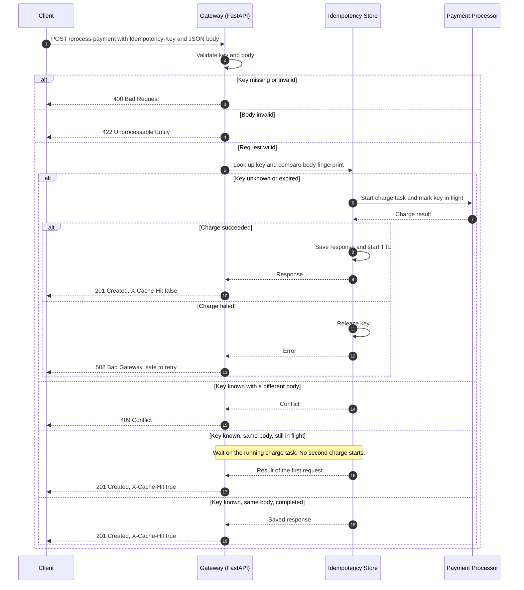

# Idempotency Gateway

## Overview

This API simulates payment processing and is designed to let clients retry requests safely using an `Idempotency-Key`. It uses FastAPI and an in-memory store in a single worker process to save and replay payment responses.

The diagram describes the target design. Implementation is being added in tested increments; the ADRs record the decisions and their limits.

## Architecture diagram



## Setup

Install Git and Python 3.11 or newer. No database or external service is required.

Clone the repository if you do not already have it:

```text
git clone https://github.com/Bixzare/AmaliTech-DEG-Project-based-challenges.git
```

Start the following commands from the repository root (`AmaliTech-DEG-Project-based-challenges`). If your terminal is already inside `backend/Idempotency-gateway`, skip the first `cd` command. Create the virtual environment once; on later visits, activate it and start the server.

### Windows Command Prompt (CMD)

```bat
cd backend\Idempotency-gateway
python -m venv .venv
.venv\Scripts\activate.bat
python -m pip install -r requirements.txt
uvicorn app.main:app --port 8000
```

### Windows PowerShell

```powershell
cd backend\Idempotency-gateway
python -m venv .venv
.\.venv\Scripts\Activate.ps1
python -m pip install -r requirements.txt
uvicorn app.main:app --port 8000
```

If PowerShell blocks the activation script, use the virtual environment's interpreter directly from the project folder:

```powershell
.\.venv\Scripts\python.exe -m pip install -r requirements.txt
.\.venv\Scripts\python.exe -m uvicorn app.main:app --port 8000
```

Confirm that `python --version` reports Python 3.11 or newer before creating the environment.

### macOS or Linux

```bash
cd backend/Idempotency-gateway
python3 -m venv .venv
source .venv/bin/activate
python -m pip install -r requirements.txt
uvicorn app.main:app --port 8000
```

Confirm that `python3 --version` reports Python 3.11 or newer before creating the environment.

### Check the running server

Open [the health endpoint](http://127.0.0.1:8000/health); it should return `{"status":"ok"}`. Open [the interactive API documentation](http://127.0.0.1:8000/docs) to send payment requests. Stop the server with `Ctrl+C`.

Run one worker process. The in-memory store is not shared across workers, and restarting the server clears its records.

### Run the tests

Stop the server, or open another terminal in the project folder and activate the same virtual environment. Then run:

```text
python -m pip install -r requirements-dev.txt
python -m pytest -q
```

On Windows, activation is optional if you use the explicit interpreter path:

```text
.venv\Scripts\python.exe -m pip install -r requirements-dev.txt
.venv\Scripts\python.exe -m pytest -q
```

### Configuration

Set environment variables before starting the server. Invalid settings prevent startup and report the variable that needs correction.

| Environment variable | Default | Rule | Purpose |
|---|---|---|---|
| `PROCESSING_DELAY_SECONDS` | `2.0` | Finite, at least zero | Simulated payment processing delay |
| `IDEMPOTENCY_TTL_SECONDS` | `86400` | Finite, greater than zero | Planned retention window for completed responses |
| `IDEMPOTENCY_SWEEP_INTERVAL_SECONDS` | `60` | Finite, greater than zero | Planned interval between expiry sweeps |

At this checkpoint, the TTL and sweep settings are validated, but expiry and background cleanup are not implemented yet.

## Design decisions

- [ADR 0001: FastAPI with an in-memory store](docs/adr/0001-fastapi-and-in-memory-store.md)
- [ADR 0002: Request validation and fingerprinting](docs/adr/0002-request-validation-and-fingerprinting.md)
- [ADR 0003: Concurrent requests share one charge task](docs/adr/0003-in-flight-requests-share-one-charge-task.md)
- [ADR 0004: Failed charges release their key](docs/adr/0004-failed-charges-release-the-key.md)

Started charges run in their own tasks. Requests for the same key and payment wait for that task through cancellation shielding, so cancelling one request does not cancel the charge. During normal shutdown, the application waits for started charges to finish. This does not protect against the process being killed or records being lost on restart.

## Developer's choice

[ADR 0005: Idempotency keys expire](docs/adr/0005-idempotency-keys-expire.md) defines a configurable retention window and periodic cleanup. Retrying after expiry creates a new payment; records are also lost on process restart.
